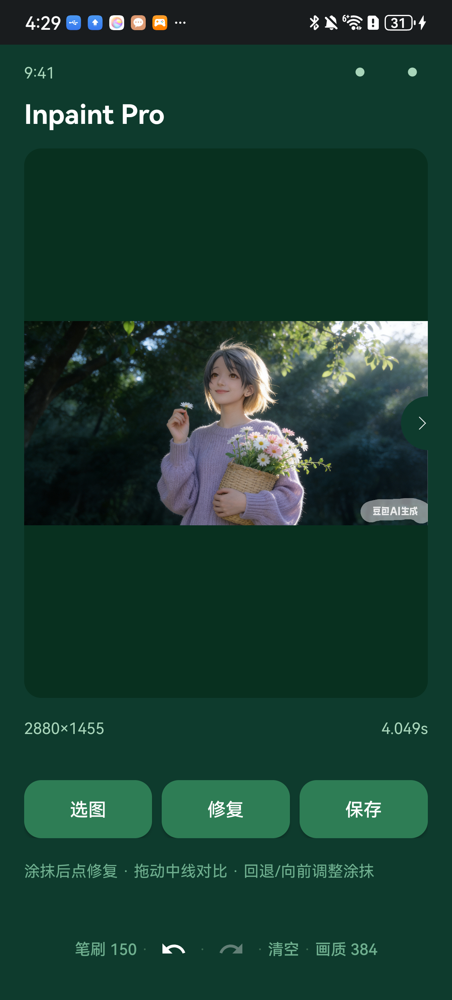

# Inpaint Pro 🪄 — On-Device AI Watermark / Object Removal (Android)

<p align="center">
  
</p>

<p align="center">
  
  
  
  
</p>

**Inpaint Pro** is a fully on-device Android app that removes watermarks, logos,
passers-by, and unwanted objects from photos — **no cloud, no network, zero
privacy leakage**. You brush over the area to erase; a local **LaMa** inpainting
model reconstructs the background pixel-by-pixel.

---

## ✨ Features

| Feature | Description |
|---|---|
| 🖼️ Pick image | Open any photo from gallery / file picker |
| 🖌️ Brush mask | Paint the region to remove with a translucent white overlay; **3 brush sizes**: 64 / 100 / 150 px |
| ⚡ One-tap repair | Runs LaMa: auto-crops the mask bounding box (+200px context) → resizes → infers → feather-blends back into the original |
| 🔍 Drag-to-compare | After repair, **drag the center handle** left/right to compare original vs. result in real time |
| ↶ ↷ Undo / Redo | Step through brush strokes independently (two dedicated icons) |
| 🧹 Clear | One tap resets all repairs back to the original image |
| 💾 Save | Export to system gallery `Pictures/OnDeviceInpaint/` at **full original resolution** (no quality loss) |
| 🎚️ Quality tiers | Switch internal inference resolution **512 / 384 / 256** to trade speed vs. detail |

> **Note on "Quality"**: this only controls the *internal* resolution LaMa uses to
> fill the erased patch. The exported image always keeps the **original
> resolution** — untouched pixels are preserved 1:1.

## 🚀 Performance

Inference runs on CPU via ONNX Runtime (XNNPACK EP + all cores). Measured on a
Huawei BRA-AL00 / EMUI 14.2 with a 2880×1455 source image:

| Quality tier | Internal size | Time |
|---|---|---|
| 512 (best detail) | 512×512 | ~7–8 s |
| 384 (balanced, default) | 384×384 | ~4 s |
| 256 (fastest) | 256×256 | ~2 s |

## 🧱 Tech Stack

- **Model**: [LaMa (big-lama)](https://github.com/saic-mdal/lama) — Fourier convolutions, SOTA for structured inpainting
- **Inference**: ONNX Runtime Mobile **1.18.0** (`arm64-v8a`), consumes the official ONNX directly — no conversion
- **Min OS**: Android 7.0 (API 24) · Target API 34
- **Build**: manual toolchain (`aapt2 → javac → d8 → zipalign → apksigner`) — bypasses Gradle (legacy build environment)

## 📂 Project Structure

```
ondevice-inpaint-app/
├── app/src/main/
│   ├── AndroidManifest.xml        # package=com.example.inpaint, no androidx
│   ├── assets/                    # model_version sentinel (onnx auto-downloaded, not in git)
│   ├── java/com/example/inpaint/
│   │   ├── MainActivity.java      # model load + mask + inference + save
│   │   ├── CompareView.java       # dual-mode canvas (paint / drag-compare) + stroke history
│   │   └── MediaStoreSaver.java   # save to system gallery
│   └── res/                       # layouts / colors / strings / vector icons
├── build_manual.py               # manual build script (see below)
├── FLUTTER_PORT_PLAN.md          # roadmap: Flutter cross-platform port
└── docs/                         # screenshots
```

## 🛠 Build

### Prerequisites (present on dev machine)
- Android SDK with `build-tools/34.0.0` (`aapt2` / `d8` / `zipalign` / `apksigner`) and `platforms/android-34`
- JDK 17
- `onnxruntime-android 1.18.0` AAR, unzipped to `classes.jar` + `jni/arm64-v8a/*.so`
  - Read from local Gradle cache by default; override via env vars:
    - `ORT_AAR` — full path to the AAR
    - `ORT_EXTRACT` — unzip dir (containing `classes.jar` and `jni/`)
  - Unzip: `unzip onnxruntime-android-1.18.0.aar -d $ORT_EXTRACT`
- Android SDK path via `ANDROID_SDK_ROOT` / `ANDROID_HOME` (default `D:/Android/Sdk`)

### Steps
```bash
python build_manual.py
```
The script will:
1. Auto-download `app/src/main/assets/lama_fp32.onnx` from HuggingFace (~199 MB) if missing
2. `aapt2` compile/link → `javac` → `d8` dex → package assets + `.so` → `zipalign` → `apksigner`
3. Output: `build_manual/app-debug.apk`

> Model weights (199 MB) exceed GitHub's 100 MB file limit and are **not** tracked.
> The build script fetches them automatically on rebuild.

## 📲 Install & Try

```bash
adb install -r build_manual/app-debug.apk
adb shell am start -n com.example.inpaint/.MainActivity
```
1. Tap **Pick** to choose a photo with a watermark
2. Brush over the watermark area (translucent white overlay)
3. Tap **Repair** — first run copies the model to private storage (~1–2 s), then results appear in seconds
4. **Drag the center handle** to compare original / repaired
5. Tap **Save** to store the result in your gallery

## 🗺️ Roadmap

- [x] On-device LaMa inference with dynamic input size (256/384/512)
- [x] Drag-to-compare, undo/redo, clear, quality tiers
- [ ] **Flutter cross-platform port** (Android + iOS) — see [`FLUTTER_PORT_PLAN.md`](FLUTTER_PORT_PLAN.md)
- [ ] INT8 quantization for ~2× faster inference
- [ ] Auto (no-brush) watermark removal mode

## 📄 License

[MIT](LICENSE) © 2026 Inpaint Pro contributors.

> The bundled LaMa model weights are released by their original authors under
> their respective license; this repo ships code only, weights are downloaded at build time.
